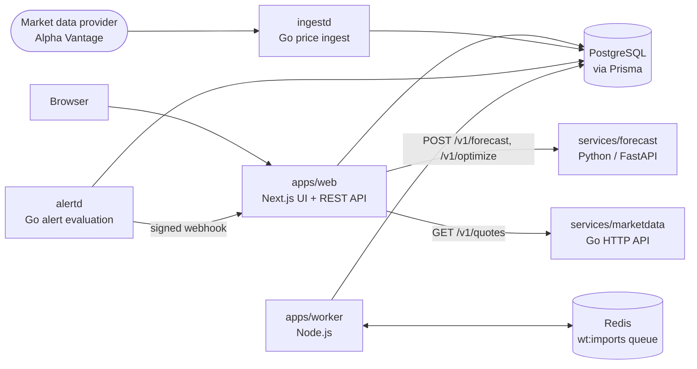

<div align="center">

# WealthTrack

**One clear view of your net worth, portfolios, budgets and goals, with Monte Carlo forecasting built in.**

[](https://github.com/your-org/WealthTrack/actions/workflows/ci.yml)
[](LICENSE)
[](https://www.typescriptlang.org/)
[](https://go.dev/)
[](https://www.python.org/)
[](https://www.prisma.io/)
[](https://nodejs.org/)

</div>

---

## Overview

Personal finances are scattered across brokerages, retirement plans, bank accounts, crypto wallets and loans. Answering simple questions, such as "what am I worth today?", "what would selling this lot cost me in tax?" or "am I on track to retire?", means juggling spreadsheets and statements.

WealthTrack consolidates all of it into a single system. It tracks accounts and holdings, keeps prices fresh through a dedicated market-data service, snapshots your net worth every night, reports tax lots under several cost-basis methods, evaluates price alerts, and projects future wealth with Monte Carlo simulation.

The Go services are the primary backend: `marketdata` ships the `ingestd` ingest daemon and the `alertd` alert evaluator. They sit behind a Next.js frontend, alongside a Python forecast service and a Node worker.

## Key features

- **Net-worth tracking** across brokerage, retirement, bank, credit card, crypto, real estate and loan accounts, with nightly historical snapshots.
- **Portfolios and holdings** with unrealised gain, allocation by asset class and performance charts.
- **Tax-lot reporting** with FIFO, LIFO, HIFO and average cost-basis methods.
- **Budgets and goals** with weekly, monthly or yearly periods and projected completion for goals (retirement, home, education, emergency, travel, custom).
- **Price alerts** (above, below, percent change up/down) evaluated by a Go service and delivered through a signed webhook.
- **Monte Carlo forecasting** (geometric Brownian motion with monthly contributions, 5th to 95th percentile bands) and **portfolio optimisation** and risk analytics in a Python service.
- **Broker CSV import** (Fidelity and Schwab parsers) processed asynchronously through a Redis-backed queue.
- **Typed, validated API** with per-route Zod-style schemas and OpenAPI generation (`scripts/gen-openapi.js`).

## Architecture



| Component | Responsibility |
|-----------|----------------|
| `apps/web` | Next.js 14 App Router UI (dashboard, portfolios, budgets, goals, forecast, tax, alerts) and the `/api` routes. |
| `services/forecast` | FastAPI service for Monte Carlo simulation, risk metrics and portfolio optimisation. |
| `services/marketdata` | Go module with `ingestd` (quote ingestion with batching, backoff and metrics), `alertd` (one-shot alert evaluation) and an HTTP quote API. |
| `apps/worker` | Nightly net-worth snapshots (02:00 UTC) and CSV import queue consumer; failed jobs go to `wt:imports:dead`. |
| PostgreSQL / Redis | System of record and job queue. |

More detail in [docs/architecture.md](docs/architecture.md).

## Tech stack

| Layer | Technology |
|-------|------------|
| Web | Next.js 14, React 18, Recharts, TypeScript |
| API | Next.js route handlers, Prisma Client |
| Forecasting | Python 3.11, FastAPI, NumPy, SciPy, pandas, Pydantic |
| Market data | Go 1.22, pgx, Alpha Vantage provider (plus a mock provider) |
| Worker | Node.js 20, ioredis |
| Data | PostgreSQL 16, Redis 7, Prisma 5 |
| Tooling | npm workspaces, Vitest, pytest, ruff, ESLint, Prettier, Docker Compose, GitHub Actions |

## Repository structure

```
WealthTrack/
├── apps/
│   ├── web/                 # Next.js app (UI, API routes, domain services)
│   └── worker/              # Snapshot job + CSV import queue consumer
├── packages/
│   ├── types/               # Shared TypeScript domain types
│   ├── utils/               # Money, date and return calculations
│   └── csv-import/          # Broker CSV parsers (Fidelity, Schwab)
├── services/
│   ├── forecast/            # FastAPI: Monte Carlo, risk, optimiser
│   └── marketdata/          # Go: cmd/ingestd, cmd/alertd, internal/*
├── prisma/                  # schema.prisma, migrations, seed.ts
├── deploy/                  # Dockerfiles and docker-compose.yml
├── docs/                    # API, architecture, data model, forecasting
├── scripts/                 # check-env, backup-db, gen-openapi, seed-prices
├── .github/                 # CI, CodeQL, lint, migrations-check, docker, release
└── Makefile
```

## Getting started

### Prerequisites

- Node.js 20 and npm
- Docker with Compose
- Python 3.11 and Go 1.22 (only to run or test the services outside Docker)

### Setup

```bash
git clone https://github.com/your-org/WealthTrack.git
cd WealthTrack

cp .env.example .env      # then edit values (see below)
npm install
```

Key variables in `.env.example`:

| Variable | Purpose |
|----------|---------|
| `DATABASE_URL` | PostgreSQL connection string |
| `REDIS_URL` | Redis connection string |
| `NEXTAUTH_SECRET` | Random secret; also used to verify alert webhook signatures |
| `FORECAST_URL` / `MARKETDATA_URL` | Base URLs of the forecast and market-data services |
| `MARKET_PROVIDER` / `ALPHAVANTAGE_API_KEY` | Quote provider and its API key |
| `ALERT_WEBHOOK_URL` | Where `alertd` delivers triggered alerts |

Validate your configuration with `npm run check-env`.

### Run the stack

```bash
make up          # postgres, redis, web, worker, forecast, marketdata (Docker Compose)
make migrate     # prisma migrate deploy
make seed        # load seed data
```

The web app is served on http://localhost:3000, the forecast service on `:8000` and the market-data API on `:8080`. Stop everything with `make down`.

### Local development

```bash
make dev                                   # Next.js dev server (apps/web)
```

Run the other services directly from their directories:

```bash
# Forecast service
cd services/forecast && pip install -r requirements.txt && uvicorn app.main:app --port 8000

# Market data: price ingestion and one-shot alert evaluation
cd services/marketdata && go run ./cmd/ingestd
cd services/marketdata && go run ./cmd/alertd --dry-run

# Background worker
npm start --workspace apps/worker
```

### Makefile targets

| Target | Action |
|--------|--------|
| `make dev` | Start the Next.js dev server |
| `make up` / `make down` | Build and start / stop the Docker Compose stack |
| `make migrate` | Apply Prisma migrations |
| `make seed` | Seed the database |
| `make test` | Run JS, Python and Go test suites |
| `make lint` | Run ESLint and ruff |

## API overview

All web routes live under `/api` and require an authenticated session. See [docs/api.md](docs/api.md) for the full reference.

| Method | Path | Description |
|--------|------|-------------|
| GET / POST | `/api/portfolios` | List portfolios with total value / create a portfolio |
| GET | `/api/holdings` | Holdings with unrealised gain (filter with `?portfolio=`) |
| GET | `/api/networth` | Net-worth time series |
| GET | `/api/budgets` | Budgets with month-to-date spend |
| GET | `/api/goals` | Goals with projected completion |
| GET | `/api/tax` | Tax-lot report |
| GET / POST | `/api/alerts` | List / create price alerts |
| POST | `/api/alerts/webhook` | Receives signed alert deliveries from `alertd` |
| POST | `/api/forecast` | Run a Monte Carlo forecast (proxied to the forecast service) |

Internal services:

| Service | Endpoint | Description |
|---------|----------|-------------|
| Forecast | `GET /healthz`, `POST /v1/forecast`, `POST /v1/optimize` | Health, simulation, optimisation |
| Market data | `GET /healthz`, `GET /v1/quotes?symbols=` | Health, latest quotes |
| Market data | `GET /v1/fx`, `/v1/fx/convert`, `/v1/dividends`, `/v1/corporate-actions/upcoming`, `/v1/news/sentiment`, `/v1/stream` | FX, dividends, corporate actions, sentiment, SSE price stream (mounted when configured) |

## Data model

Defined in [`prisma/schema.prisma`](prisma/schema.prisma) and documented in [docs/data-model.md](docs/data-model.md).

| Model | Description |
|-------|-------------|
| `User` | Owner of all data |
| `Account` | Financial account (brokerage, retirement, bank, credit card, crypto, real estate, loan) |
| `Portfolio`, `Holding`, `Security` | Portfolios, positions and the securities they reference |
| `Transaction`, `TaxLot` | Trades and cash movements; lots for cost-basis reporting |
| `PriceQuote` | Ingested market prices |
| `Budget`, `BudgetCategory` | Periodic budgets and their categories |
| `Goal` | Financial goals |
| `PriceAlert` | Alert rules with condition and status |
| `NetWorthSnapshot` | Nightly asset, liability and net-worth history |
| `CsvImport` | Broker import jobs and their status |
| `ForecastRun` | Saved forecast runs |
| `Dividend`, `CorporateAction` | Dividend history and splits/mergers per security |
| `Watchlist`, `WatchlistItem`, `Benchmark` | Watched securities and comparison benchmarks |
| `RecurringContribution` | Scheduled deposits toward accounts and goals |
| `Liability`, `RealEstateAsset`, `Insurance`, `CryptoWallet` | Debts, property, policies and wallets outside brokerage accounts |
| `TaxDocument` | Uploaded tax forms by year |
| `ExchangeRate`, `NewsItem` | FX rate history; scored news headlines |
| `Notification` | Delivered or pending user notifications |

## Testing

```bash
make test      # npm workspaces (Vitest), pytest for forecast, go test for marketdata
make lint      # ESLint across workspaces, ruff for the forecast service
```

CI ([`ci.yml`](.github/workflows/ci.yml)) runs `prisma validate`, lint, tests and build for the web workspaces, `pytest` for the forecast service, and `go vet` plus `go test` for market data. Separate workflows cover CodeQL, migration checks, Docker images and releases.

## Deployment

- `deploy/docker-compose.yml` defines PostgreSQL 16, Redis 7, web, worker, forecast and marketdata; `make up` builds and starts it.
- Per-service Dockerfiles: `deploy/Dockerfile.web`, `deploy/Dockerfile.worker`, `services/forecast/Dockerfile`, `services/marketdata/Dockerfile`.
- Apply migrations with `make migrate` (`prisma migrate deploy`). Each migration directory includes a `down.sql` and README.
- `scripts/backup-db.sh` writes timestamped `pg_dump` backups to `backups/`.
- Images are built by the `docker.yml` workflow and releases by `release.yml`.

Before production use, replace the Compose database credentials and `NEXTAUTH_SECRET`, and supply a real `ALPHAVANTAGE_API_KEY`.

## Security

- API routes resolve the user from the session header set by your authentication proxy (`x-wt-user-email`) and reject unknown users with 401.
- Alert webhooks are authenticated with an HMAC-SHA256 signature (`x-wt-signature`) verified in constant time.
- Secrets are supplied through environment variables; `.env` is git-ignored.
- CodeQL scanning and Dependabot are enabled.

Report vulnerabilities privately as described in [SECURITY.md](SECURITY.md).

## Roadmap

- Additional broker CSV parsers beyond Fidelity and Schwab
- Additional market-data providers behind the existing provider interface
- Broader API coverage (update and delete operations for existing resources)
- Richer portfolio optimisation and risk reporting

## Contributing

Contributions are welcome. Please read [CONTRIBUTING.md](CONTRIBUTING.md) and our [Code of Conduct](CODE_OF_CONDUCT.md) first. Changes are tracked in [CHANGELOG.md](CHANGELOG.md).

## License

Released under the [MIT License](LICENSE).
